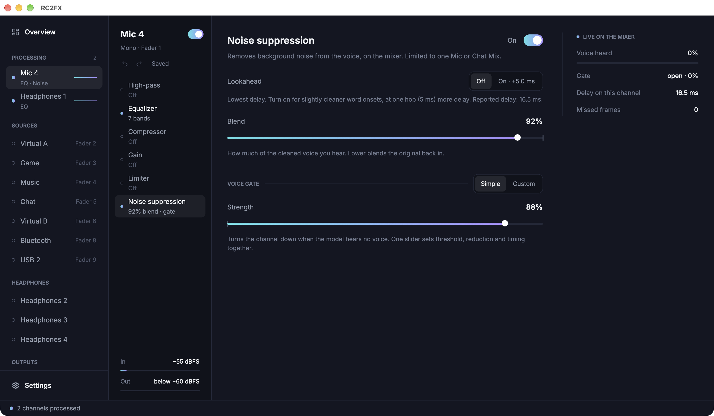
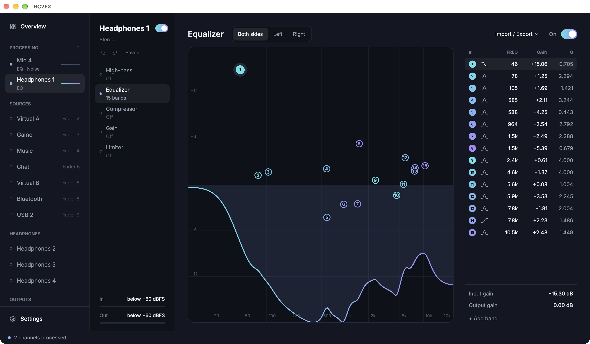

# RC2FX

RC2FX adds a full suite of audio effects to the RØDECaster Pro II: a 32-band
parametric EQ, AI noise suppression, a compressor, a limiter, a high-pass
filter, and a gain stage. Everything runs right on the mixer inside RØDE's
audio engine, so every computer, console, or phone connected to it gets the
processed sound. You configure it from a desktop app on Windows, macOS, or
Linux over USB, and your settings stay on the mixer even after you close the
app.




## Download

| System | Download |
| --- | --- |
| Windows (x64) | [Setup (.exe)](https://github.com/ibanks42/rc2fx/releases/latest/download/rc2fx-windows-x64-setup.exe) |
| macOS 13+ (Apple silicon & Intel) | [Installer (.pkg)](https://github.com/ibanks42/rc2fx/releases/latest/download/rc2fx-macos-universal.pkg) |
| Linux (x64) | [AppImage](https://github.com/ibanks42/rc2fx/releases/latest/download/rc2fx-linux-x64.AppImage) |

Release notes and checksums are on the
[latest release](https://github.com/ibanks42/rc2fx/releases/latest) page. Once
you have the app, follow
[Getting started](https://rc2fx.ibanks.dev/user/getting-started).

## Features

- **32-band parametric EQ** per channel, with import support for Equalizer APO,
  AutoEQ, and EasyEffects presets.
- **DeepFilterNet3 noise suppression**, retrained to handle keyboard and mouse
  clicks, plus an optional voice gate.
- **Chat Mix Out noise suppression**, which cleans up every microphone on your
  call while leaving Smart Pads and music untouched.
- **Compressor, limiter, high-pass filter, and gain**, freely reorderable on
  every channel.
- **25 channels on the Pro II**: microphones, wireless receivers, USB and Chat
  inputs, CallMe, Bluetooth, virtual USB inputs, all four headphone outputs,
  monitors, and USB mix outputs.

Nothing is processed on a fresh install until you turn a channel on. If you
ever want to remove RC2FX, flashing stock RØDE firmware puts the mixer right
back to normal.

## Quick start

1. [Download](#download) and install the app for your OS.
2. Plug your computer into the mixer's **USB 1** port.
3. Click **Install RC2FX**. The app downloads official RØDE firmware, adds
   RC2FX to it, and flashes your mixer over USB.
4. Pick a channel, turn on **Processing**, and dial in your effects. Changes
   apply immediately and save to the mixer automatically.

See the [user guide](docs/introduction.md) for the full walkthrough.

RC2FX supports Pro II firmware 1.7.7 and 1.7.6. RØDECaster Duo support is
[experimental and untested on hardware](docs/reference/duo.md) and stays off
unless you opt in.

## Building from source

The desktop app is written in Go, and the mixer runtime is Rust. You'll need
[Go](https://go.dev/dl/) (the version in `desktop/go.mod`), a C compiler for
cgo (MinGW-w64 gcc on Windows), Rust ([rustup](https://rustup.rs)), and either
[mise](https://mise.jdx.dev) (optional, installs the pinned `just`, `zig`,
linters, and Linux packaging tools from `mise.toml`) or
[zig](https://ziglang.org/download/) and [just](https://just.systems) on `PATH`
([details](docs/developer/building.md)).

```sh
git clone https://github.com/ibanks42/rc2fx
cd rc2fx
just setup          # once: libraries, pinned tools, mixer build tools, packaging tools, and git hook
just app            # run the desktop app (dev build)
just test           # run lints, Go tests/vet (and Rust tests/clippy on Linux)
just mixer-build    # cross-build the mixer runtime into target/mixer
```

See the [developer guide](docs/developer/index.md) for setup details and how
the project is organized.

## License

RC2FX's code and trained noise suppression weights are MIT licensed
([LICENSE-MIT](LICENSE-MIT)). Third-party licenses are in
[THIRD_PARTY_NOTICES.md](THIRD_PARTY_NOTICES.md), and training dataset credits
are in [crates/rc2fx-dfn/model/PROVENANCE.md](crates/rc2fx-dfn/model/PROVENANCE.md).

RC2FX is an unofficial project and is not affiliated with or endorsed by RØDE.
It is provided as-is without warranty, and installing it may void your
warranty.
